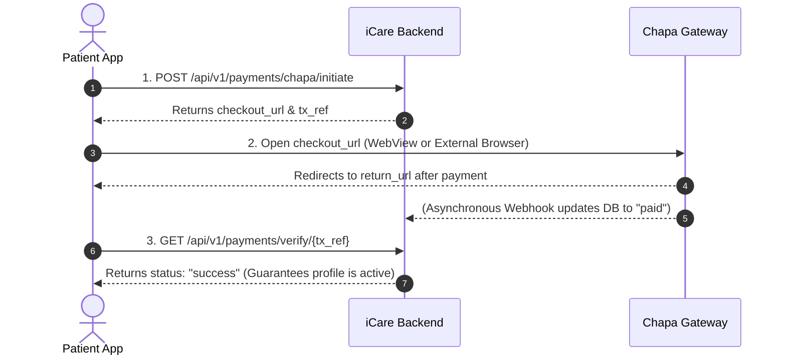

# Child Registration Payment - Frontend Integration Guide

This guide describes how the mobile and web client should integrate with the child registration and profile activation payment flow via Chapa.

---

## 1. Overview & Architecture Flow



---

## 2. Integration Steps

### Step 1: Initiate Payment
When the user registers a child or chooses to activate an unpaid child profile, call the initiation endpoint:

* **Method:** `POST`
* **Path:** `/api/v1/payments/chapa/initiate`
* **Headers:**
  ```http
  Authorization: Bearer <patient_access_token>
  Content-Type: application/json
  ```
* **Request Body:**
  ```json
  {
    "kind": "child_registration",
    "child_id": "a55ff62d-35b8-41a4-a564-cc3ad99896aa",
    "amount": 10.00,
    "currency": "ETB",
    "return_url": "https://yourapp.com/payments/return",
    "email": "patient@example.com",
    "first_name": "Abebe",
    "last_name": "Kebede"
  }
  ```

* **Response (200 OK):**
  ```json
  {
    "ok": true,
    "tx_ref": "icare-child_registration-6672fdaf3cd6445b",
    "checkout_url": "https://checkout.chapa.co/checkout/payment/...",
    "dev": false
  }
  ```

> **Important:** Save `tx_ref` locally on the device (in application state or local storage) before redirecting the user to the checkout page.

---

### Step 2: Open Chapa Checkout Page
* Open `checkout_url` in an in-app browser/WebView or default web browser.
* The user completes payment using Telebirr, CBEBirr, cards, or other supported Ethiopian payment methods.
* Upon completion, Chapa redirects back to your provided `return_url`.

---

### Step 3: Verify Payment On Return (Recommended)
When the user returns to the app from the browser:

* **Method:** `GET`
* **Path:** `/api/v1/payments/verify/{tx_ref}`
* **Headers:**
  ```http
  Authorization: Bearer <patient_access_token>
  ```
* **Response (200 OK):**
  ```json
  {
    "ok": true,
    "kind": "child_registration",
    "tx_ref": "icare-child_registration-6672fdaf3cd6445b",
    "status": "success",
    "child_id": "a55ff62d-35b8-41a4-a564-cc3ad99896aa"
  }
  ```

> **Why call `/verify/{tx_ref}`?**
> Chapa webhooks may occasionally experience slight network delays. Calling the verification endpoint guarantees instant synchronization with Chapa and transitions the child's `payment_status` to `"paid"` immediately without waiting.

---

## 3. Querying Status & Child Profile

### Check Payment Status Directly
* **Method:** `GET`
* **Path:** `/api/v1/payments/children/{child_id}/status`
* **Headers:**
  ```http
  Authorization: Bearer <patient_access_token>
  ```
* **Response (200 OK):**
  ```json
  {
    "ok": true,
    "child_id": "a55ff62d-35b8-41a4-a564-cc3ad99896aa",
    "payment_status": "paid",
    "amount_paid": "10.00",
    "currency": "ETB",
    "payment_method": "chapa",
    "paid_at": "2026-10-20T17:21:33.456001+00:00",
    "tx_ref": "icare-child_registration-6672fdaf3cd6445b"
  }
  ```

### Standard Child Profile Endpoint
The child profile itself also includes the payment fields:
* **Method:** `GET`
* **Path:** `/api/v1/children/{child_id}`
* **Response includes:**
  ```json
  {
    "id": "a55ff62d-35b8-41a4-a564-cc3ad99896aa",
    "name": "Sara",
    "payment_status": "paid",
    "amount_paid": 10.00,
    "payment_method": "chapa",
    "paid_at": "2026-10-20T17:21:33.456001+00:00"
  }
  ```

---

## 4. Notifications
Once payment is confirmed (via webhook or verification), the backend automatically dispatches:
* An in-app notification with type `child_payment_confirmed`.
* A real-time FCM push notification to the parent device informing them that the child's profile is now active.
