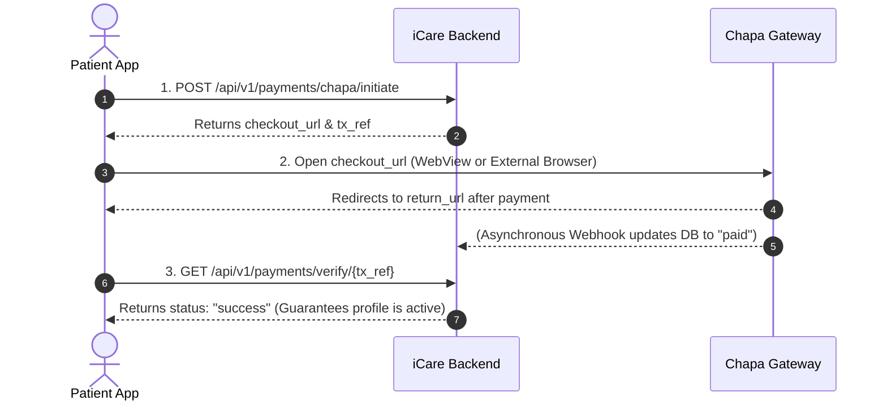

# Pregnancy Registration Payment - Frontend Integration Guide

This guide describes how the mobile and web client should integrate with the pregnancy registration and profile activation payment flow via Chapa.

---

## 1. Overview & Architecture Flow



---

## 2. Integration Steps

### Step 1: Initiate Payment
When the user creates a pregnancy profile or chooses to activate an unpaid pregnancy profile, call the initiation endpoint:

* **Method:** `POST`
* **Path:** `/api/v1/payments/chapa/initiate`
* **Headers:**
  ```http
  Authorization: Bearer <patient_access_token>
  Content-Type: application/json
  ```
* **Request Body:**
  ```json
  {
    "kind": "pregnancy_registration",
    "pregnancy_id": "b78ee71c-46a9-45f2-9cb3-112233445566",
    "return_url": "https://yourapp.com/payments/return",
    "email": "patient@example.com",
    "first_name": "Selam",
    "last_name": "Ayen"
  }
  ```

> **Note on Amount:** The `amount` field is optional. The backend automatically enforces the fee configured in the system finance settings (`pregnancyRegistrationFee`).


* **Response (200 OK):**
  ```json
  {
    "ok": true,
    "tx_ref": "icare-pregnancy_registration-9f8e7d6c5b4a3210",
    "checkout_url": "https://checkout.chapa.co/checkout/payment/...",
    "dev": false
  }
  ```

> **Important:** Save `tx_ref` locally on the device (in application state or local storage) before redirecting the user to the checkout page.

---

### Step 2: Open Chapa Checkout Page
* Open `checkout_url` in an in-app browser/WebView or default web browser.
* The user completes payment using Telebirr, CBEBirr, cards, or other supported Ethiopian payment methods.
* Upon completion, Chapa redirects back to your provided `return_url`.

---

### Step 3: Verify Payment On Return (Recommended)
When the user returns to the app from the browser:

* **Method:** `GET`
* **Path:** `/api/v1/payments/verify/{tx_ref}`
* **Headers:**
  ```http
  Authorization: Bearer <patient_access_token>
  ```
* **Response (200 OK):**
  ```json
  {
    "ok": true,
    "kind": "pregnancy_registration",
    "tx_ref": "icare-pregnancy_registration-9f8e7d6c5b4a3210",
    "status": "success",
    "pregnancy_id": "b78ee71c-46a9-45f2-9cb3-112233445566"
  }
  ```

> **Why call `/verify/{tx_ref}`?**
> Chapa webhooks may occasionally experience slight network delays. Calling the verification endpoint guarantees instant synchronization with Chapa and transitions the pregnancy's `payment_status` to `"paid"` immediately without waiting.

---

## 3. Querying Status & Pregnancy Profile

### Check Payment Status Directly
* **Method:** `GET`
* **Path:** `/api/v1/payments/pregnancies/{pregnancy_id}/status`
* **Headers:**
  ```http
  Authorization: Bearer <patient_access_token>
  ```
* **Response (200 OK):**
  ```json
  {
    "ok": true,
    "pregnancy_id": "b78ee71c-46a9-45f2-9cb3-112233445566",
    "payment_status": "paid",
    "amount_paid": "500.00",
    "currency": "ETB",
    "payment_method": "chapa",
    "paid_at": "2026-10-21T18:10:00.000000+00:00",
    "tx_ref": "icare-pregnancy_registration-9f8e7d6c5b4a3210"
  }
  ```

### Standard Pregnancy Profile Endpoint
The pregnancy profile itself also includes the payment fields:
* **Method:** `GET`
* **Path:** `/api/v1/pregnancies`
* **Response includes:**
  ```json
  [
    {
      "id": "b78ee71c-46a9-45f2-9cb3-112233445566",
      "user_id": "0ef4ee19-c179-4152-82f1-4080cce96009",
      "lmp_date": "2026-08-20",
      "edd": "2027-05-27",
      "status": "active",
      "payment_status": "paid",
      "amount_paid": 500.00,
      "payment_method": "chapa",
      "payment_tx_ref": "icare-pregnancy_registration-9f8e7d6c5b4a3210",
      "paid_at": "2026-10-21T18:10:00.000000+00:00"
    }
  ]
  ```

---

## 4. Admin Management

Admins can view and manually activate care profile payments:

### 1. Manual Activation
* **Method:** `POST`
* **Path:** `/api/v1/admin/pregnancies/{pregnancy_id}/activate`
* **Headers:**
  ```http
  Authorization: Bearer <admin_access_token>
  ```
* **Request Body:**
  ```json
  {
    "amount": "500.00",
    "payment_method": "cash_receipt"
  }
  ```

### 2. List Payments
* **Method:** `GET`
* **Path:** `/api/v1/admin/care-profile-payments` (or `/api/v1/admin/child-payments`)
* **Query Parameters:**
  - `pregnancy_id`: Filter by pregnancy ID
  - `child_id`: Filter by child ID
  - `payment_type`: Filter by `"pregnancy"` or `"child"`
  - `status`: Filter by `"success"`, `"pending"`, etc.

---

## 5. Notifications
Once payment is confirmed (via webhook or verification), the backend automatically dispatches:
* An in-app notification with type `pregnancy_payment_confirmed`.
* A real-time FCM push notification to the patient device informing them that their pregnancy profile is now active.
